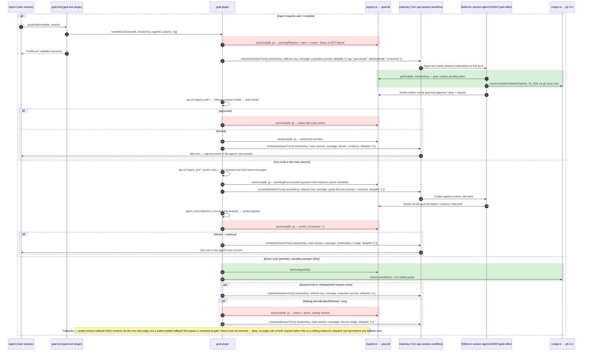

# goal — the OpenClaw goal plugin

Per-session goal ownership: the agent declares its goal, a judge audits it at every turn-end, and an unreached goal pushes a continuation prompt into the idle session. Reactive, event-driven — no timer, no hourly poll.

## Status (2026-11-16, end of day)

Built, loaded, and mostly verified live. The Judge, registry, stall detector, judge-outage pause, and overwrite protection all work. **Two things are NOT yet verified live:** (1) the `goal` tool is not yet visible to the agent in a live turn — Tony got "Tool named `goal` is not available" (see "Tool registration" below; a fix is built and on disk, it loads on the next gateway restart); (2) the push (continuation prompt via agentTurn) was attempted twice and failed both times while the gateway was unresponsive — a successful push is not yet verified. **OpenClaw has built-in goal tools** (`get_goal`, `create_goal`, `update_goal` in `src/agents/tools/goal-tools.ts`) that the spec missed — they ARE visible to the agent. If the custom `goal` tool still does not appear after the restart, pivot the tool surface to the built-in tools and have the Judge read OpenClaw's session-goal store.

## What it is

- **`goal` tool** (the agent calls it): `get` / `create` / `link` / `complete` / `wait` / `resume` / `clear`, plus the Muse-mirroring management actions `list` / `search` / `update` / `set_status` / `create_entry` / `update_entry` / `delete_entry` / `delete` (see "Management actions" below). `create` takes the objective + the acceptance criteria the agent writes itself — that declaration IS the inference. `complete` runs the audit and refuses when the verdict is not DONE.
- **Registry**: SQLite `goal.db` in the OpenClaw state dir. One row per session, keyed to the session KEY (`agent:<id>:main`) — stable, survives compaction (fixes Hermes bug 1). The live goal state lives ONLY here, never in a file. Each row also carries `entries`: dated progress notes `{id, title, current_state, description, effective_at}` (mirrors Muse's `create_entry` / `update_entry` / `delete_entry`), stored as JSON in the row. DBs created before the `entries` column get it added on open (migration in `openRegistry`).
- **Judge**: a separate one-shot model call (`openclaw capability model run`) asking "is the goal DONE?". Runs at EVERY turn-end, agent goals included (fixes Hermes bug 2). After N consecutive outages it pauses the goal instead of running unaudited forever (fixes Hermes bug 3). The judge checks the criteria against the ORIGINAL USER ASK (fixes Hermes bug 4).
- **Push**: when the turn ends and the goal is not reached, the plugin pushes a continuation prompt into the idle session via `openclaw agent --session-key ... --message ...` (agentTurn). The push IS the wake.

## Install

```sh
npm run build
openclaw plugins install --link /home/engineer/.openclaw/goal-plugin
openclaw plugins list   # goal should be loaded
```

No gateway restart needed (`plugins install --link` loads it live). Config lives in `plugins.entries.goal` in openclaw.json (see `openclaw.plugin.json` for the schema). The Judge model defaults to `openrouter/nvidia/nemotron-3.5-super-vl:free` (free OpenRouter tier). Judge fallback chain (0.2.2): if the configured judge model fails on transport (429, timeout, CLI error), the Judge tries each `judgeFallbackModels` entry in order; with no explicit list, the built-in default is the fallback — a single model's 429 can never strand a verdict (2026-11-19: beam-free 429'd and every verdict came back judge_unavailable).

**Reloading:** do NOT use `openclaw plugins reload goal` to load new code. The plugin's background work (Judge ~60s, push minutes) keeps it "busy", and the plugin host only waits 5s to drain — the reload fails with "Previous plugin cleanup failed" and can leave the plugin retired. Load new code with a **gateway restart** instead.

## Tool registration (the `goal` tool must be visible to the agent)

The tool is registered with `api.registerTool(factory, { name: "goal" })`. The factory MUST never return null for a missing sessionKey: the runtime may call the factory once globally (no session context) to extract static metadata, and a null there drops the tool entirely. The factory derives the session key from the agent id (`agent:<id>:main`) when the sessionKey is absent, and only returns null when the agent is not in the enabled-agents allowlist. If the sessionKey is empty at execute time, the tool fails cleanly instead of writing under an empty key.

## Operator: set Den's goal for an agent

```sh
node scripts/goal-admin.mjs set-user-goal agent:product-lead-agentpod:main product-lead-agentpod \
  "Make Mallow public release ready, first $10K MRR" \
  "Public release is live; first $10K MRR reached" \
  "Run: gh release + Play listing live; MRR: Stripe dashboard"
node scripts/goal-admin.mjs list
node scripts/goal-admin.mjs search "Mallow"
node scripts/goal-admin.mjs get agent:product-lead-agentpod:main
```

A user-set goal always wins and cannot be replaced by the agent's `create`.

## Management actions (Muse-mirroring, 0.2.0)

Every action works on the **calling session's goal**, except `list` / `search`, which list goals visible to the caller — goals for sessions of the **same agent id**. Another agent's goals are never exposed (the registry is shared across agents on one gateway, and goal text can contain user asks).

| Action | What it does |
|---|---|
| `list` | All non-cancelled goals for this agent (goal, status, source, turns_used, last_verdict, status_line each). |
| `search` | `query` (min 2 chars); case-insensitive match against goal text, acceptance criteria, and entry titles/descriptions. Same view as `list`. |
| `update` | Change `objective`, `acceptance_criteria`, `verification`, `max_turns`, or `subgoals` of your own goal; `revision` += 1. Refused for user-set goals. |
| `set_status` | `status=active\|completed` + non-empty `reason`. `completed` keeps the row + history (does NOT delete); `active` reopens a done/cancelled/paused goal. Refused for user-set goals (use `complete`, audited, to finish one) — unless the user already cleared it. |
| `create_entry` | Append a dated progress note (`title`, `current_state`, `description`, optional `effective_at`); returns the entry id. |
| `update_entry` | Edit an entry in place (`update_id` + at least one of title/current_state/description/effective_at). |
| `delete_entry` | Remove one entry (`update_id`). |
| `delete` | Remove the goal row entirely — only for mistakes / explicit user request; requires `confirm=true`. Refused for user-set goals. Finished goals should use `set_status` completed instead. |

Muse's `delete_briefing` has no OpenClaw equivalent and is intentionally not mirrored. Muse's `user_goal.create` / `get` map to the existing `create` / `get`; `create_entry` / `update_entry` / `delete_entry` map 1:1. Tracking is a separate surface and is not part of this plugin.

## Reference

- Spec: `goal-mechanism-spec.md` (Hermes goal tool + registry + Judge).
- Hermes: `tools/goal_tool.py`, `hermes_cli/goals.py` (judge_goal:1313, evaluate_after_turn, next_continuation_prompt:2300).


## Flow



## Deployment: bundled placement required

The plugin's pushes and reflector dispatches run through
`api.session.workflow.scheduleSessionTurn`. In OpenClaw 2026.11.2 core
silently refuses that call unless the plugin record's origin is
`"bundled"` (`schedulePluginSessionTurn` returns without a job handle;
`dist/registry-*.mjs`). Origin is path-based: plugin discovery promotes
a candidate to `"bundled"` when its **realpath** is inside the core
package's bundled extensions dir (`<core>/dist/extensions`), and the
bundled root scan only accepts packages physically inside that root
(`dist/discovery-*.mjs`, `isHostBundledPluginRoot`).

Therefore, on the host:

- The real plugin directories must live at
  `<core>/dist/extensions/goal-plugin` and `<core>/dist/extensions/goal-tool`,
  and `plugins.load.paths` in `openclaw.json` must point there.
  A symlink from the bundled dir to an outside path does **not** work
  (realpath escapes the root); a symlink at the legacy path
  (`~/.openclaw/goal-plugin`) pointing **in** is fine.
- `deliveryMode` for scheduled turns is `"announce"`: with `"none"`,
  cron turns in channel-bound sessions fail in core's plugin-tool
  delivery setup ("plugin delivery capability is no longer active" —
  reproduced with a core-created job, so it is a core defect, not a
  plugin one).
- A core upgrade wipes `dist/extensions`. Pristine copies live outside
  the core tree (`~/.openclaw/goal-plugin-src`, `~/.openclaw/goal-tool-src`);
  `scripts/ensure-bundled.sh` (in this package) idempotently restores
  the bundled copies when they are missing. Run it after every core
  upgrade, then restart the gateway.
